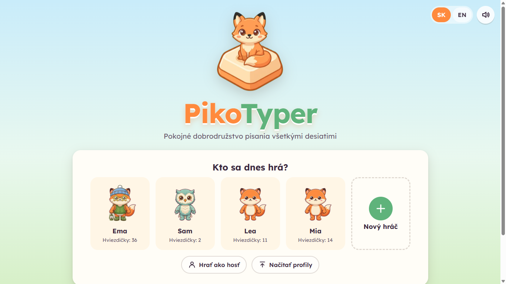
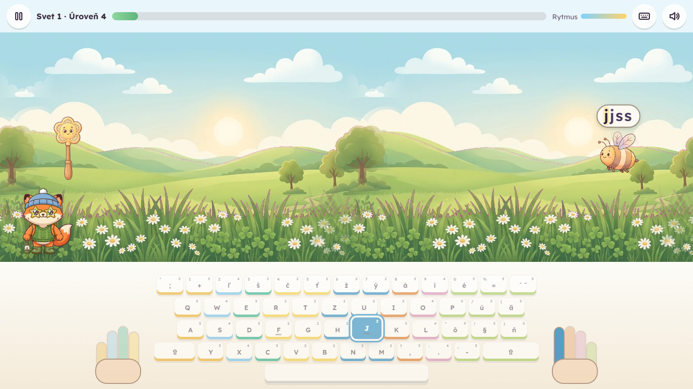
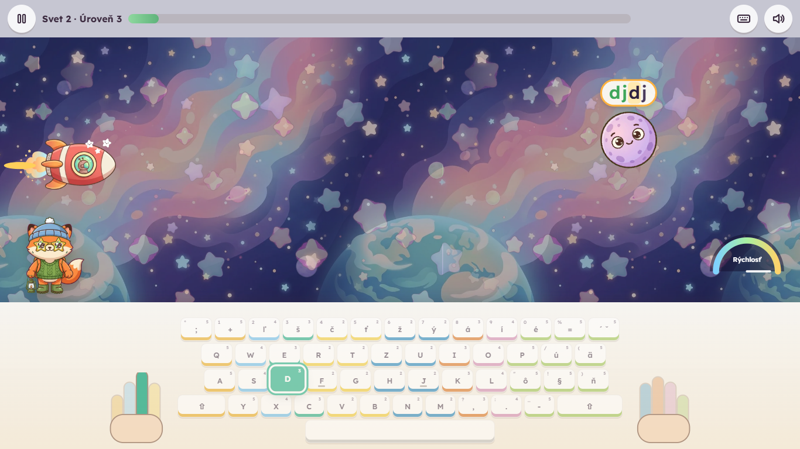

# PikoTyper

A peaceful, story-driven touch-typing adventure for children (about 10-15 years).
Kids learn to type with **all ten fingers** together with their friend **Piko**: they play catch
with animals on a meadow, fly a rocket through space, explore a new planet, protect dragons and
hatch a new friend. No explosions, no punishment, no ads, no accounts.

*Pokojná príbehová hra pre deti na nácvik písania všetkými desiatimi. Po slovensky aj po anglicky.*

**Play:** https://atiris.github.io/pikotyper/



## How it teaches

- **One key at a time.** Keys unlock from the home row (`F` `J`, then `D` `K`, `S` `L` ...),
  each new key is introduced alone (where it is, which finger), then mixed with known keys.
  The next key unlocks when the last one is mastered (40 recent presses, 92 % accuracy,
  steady reaction time).
- **Real sentences early.** Space comes with the first keys, period and comma with the
  letters, and capitals in the middle of the path, one Shift at a time; targets grow from
  `fj jf` to short phrases like `Ema ide.`
- **Every key has its finger.** The on-screen keyboard shows finger colors and numbers,
  lights up the next key (and both steps of Slovak accent keys), and two hands show which
  finger to use. The guide fades for keys the child already masters.
- **Accuracy before speed.** Stars come from accuracy; speed is only a personal trend.
  Mistakes never cost anything: the letter wobbles, the right key glows, and after three
  misses on one key Piko offers a 20-second mini practice.
- **Weak keys come more often**, and the stats overlay (click Piko) shows which keys to
  practise, with a one-minute drill.
- **Grows with the child.** Difficulty and word length go up in small automatic steps
  after a few minutes of accurate play, and every step earns a medal.
- **Piko keeps the child curious and helps out.** After a level he asks a question about
  the next one and answers it only when that level is done. Fifteen words in a row
  without a mistake charge a paw (three at most): on Enter, Piko's paws replace the hands
  and type the three closest words, which never count in the stats. Backspace lets Piko
  help by himself when the screen gets full and a word is close to its end.
- **Per-key stats** count only the last 50 presses, show what a key is mixed up with and
  how it changed day by day; click any key on the stats keyboard.
- **Good habits:** before every adventure a "Ready, steady, type!" card with one posture
  reminder and a two-letter password to start, a short preparation tip each session
  (47 tips), and a stretch break after the session length the parent chose.
- **Slovak keyboards done right:** QWERTZ and QWERTY variants, `ľ š č ť ž ý á í é` on the
  number row, `ú ä ô ň`, dead keys for `ó ĺ ŕ ď` and accented capitals, and a hint when
  the real keyboard looks different.

## The game

| World | What happens | Big challenge | Reward |
|---|---|---|---|
| 1. Training Meadow | goalkeeper Piko fans back the leaves bees, ladybugs and mice send him; a miss is a cheered goal | hedgehog throwing leaf volleys | invitation to space, meet Piko |
| 2. Rocket Flight | typing rhythm drives the speedometer, a beam pushes rocks away | splitting asteroid | landing clearance |
| 3. New Planet | stepping stones across a swamp, road signs | cracking boulder | the Force |
| 4. Dragon Valley | shield bubbles protect baby dragons | rhythm wave | a dragon egg |
| 5. Egg Journey | the egg jumps over rocks and stumps | friendly mole | a baby dragon, endless rescue missions |

Piko can be one of nine animals and wears 28 accessories earned by progress (never by chance).




## For parents

- **Private:** 100 % in the browser. No backend, no tracking, no cookies. Profiles stay in
  `localStorage` and can be exported / imported as a `.json` file. Guest mode keeps nothing.
  Links (tasks, results, moving a player) carry their data in the address hash, which never
  reaches a server.
- **Parent area** (gear button, one confirm question): child and companion names, keyboard layout, active keys (automatic or picked by hand), word
  length and difficulty 1-10 (automatic or fixed), words without diacritics, no time pressure, session length,
  guide visibility, volumes, fonts (Lexend, Atkinson Hyperlegible, OpenDyslexic), large
  text, reduced motion, high contrast. A dashboard shows a per-key heat map, accuracy and
  rhythm trends, time per day, and a printable progress card.
- **Own content** (its own tab): encouraging messages, own questions and answers that take
  turns with the companion's questions, own words (for example this week's spelling words)
  and an own text, mixed into the levels by a share you pick. The text can also be typed
  in order as free practice ("My text").
- **Surprises:** this is meant for real rewards. Hide a treat, a trip or a game evening
  behind a level: write a question ("Do you know where Dad hid a sweet reward?") and the
  answer ("In the cupboard behind the fridge."). The companion asks the question before
  that level and shows the answer only once, after the level is done well enough (the
  stars you choose); otherwise it says "almost, try once more" and keeps the secret.
- **Reading aloud:** a button in the level bar reads the word to type and the companion's
  lines with the browser's own voice (shown when the browser has one for the language).
- **Direct links:** each child's map has its own address (`.../pikotyper/#/p/<id>`), so you
  can bookmark it or put it on the desktop. Leaving the app asks first.
- **Quick sound button:** normal, quiet (20 %) or off.
- **Super mode (secret password):** on the start screen, type `superpikotyper` quickly
  (within 4 seconds, no text field needed). A temporary "Super Piko" player opens with
  every world, level, key and accessory unlocked, to look around or test. Nothing it does
  is saved or counted in anyone's statistics; end it with the star in the top right corner or a reload.
- **Offline:** installable PWA; works without internet after the first visit.
- **Move to another computer:** the data tab makes a link (and a QR code) with the whole
  player; open it on the other computer. Very large profiles go by file export instead.

## For teachers

No accounts and no server: tasks and results travel as links you send yourself (Edupage,
e-mail), with the data inside the link.

- **Give a task:** parent area, tab "Task": a name, the words and/or a text, 1-20 minutes,
  and free practice or story levels with those words. Copy the link or show the QR code.
- **The child** opens the link, picks their player (or makes a new one) and sees
  "Today's task" first on the map. When the minutes are played, "Hand in" gives a result
  link to send back.
- **Your table:** "For teachers" at the bottom of the start page. Open or paste result
  links; each child's result (minutes, accuracy, rhythm, five weakest keys) is kept in your
  browser only, grouped by task, with CSV export. A checksum shows damaged links; it does
  not stop cheating.

## Development

Requires Node.js 24+.

```sh
npm ci
npm run dev      # http://localhost:5173/pikotyper/
npm run build    # type check + production build into dist/
npm test         # unit tests (Vitest)
npm run test:e2e # browser tests (Playwright)
npm run assets   # turn raw images and music in assets-src/ into public/assets/
npm run icons    # render the PWA icons
```

Every push to `main` builds the site and deploys it to GitHub Pages
(`.github/workflows/deploy.yml`).

## Project docs

- [`pikotyper.md`](pikotyper.md) - the original brief
- [`.specify/`](.specify/) - what the product does and why, per feature
- [`.research/`](.research/) - research of similar products and proposed features
- [`.todo/`](.todo/) - implementation plans, queue and backlog
- [`.scenarios/`](.scenarios/) - end-to-end test scenarios
- [`assets-src/PROMPTS.md`](assets-src/PROMPTS.md) - Gemini prompts for images and music

## License

[MIT](LICENSE). Fonts: SIL Open Font License (see `public/fonts/`).
